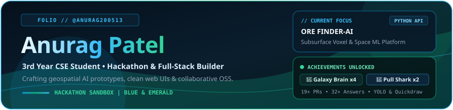
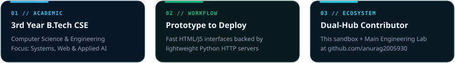
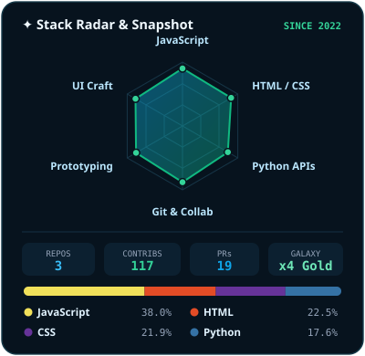

  

 

  

 

<table>
<tr>
<td width="56%" valign="top">

### 🧭 Featured Builds &amp; Contributions

- 🚀 **[ORE FINDER-AI (`hackthon`)](https://github.com/anurag200513/hackthon)**
  Space remote-sensing &amp; subsurface voxel mining intelligence platform with a custom Python REST server &amp; `vercel.json` edge setup.
  `Python` · `JavaScript` · `HTML5` · `CSS3`

- 🎨 **[Personal Web Playground (`My-website`)](https://github.com/anurag200513/My-website)**
  Clean multi-page HTML/CSS architecture, static layouts, and cross-account collaboration sandbox.
  `HTML5` · `CSS3` · `Git`

- 🌡️ **[ThermaGuard (`anurag2005930/temp`)](https://github.com/anurag2005930/temp)**
  Upstream collaborator on real-time Android ADB CPU/battery thermal telemetry &amp; API documentation.
  `Python` · `ADB` · `SSE`

- ⚡ **[CPU &amp; GPU Test Bench (`anurag2005930/cpu-gpu-benchmark`)](https://github.com/anurag2005930/cpu-gpu-benchmark)**
  Flagship systems project from my primary lab — Native CUDA Driver API + NVML hardware benchmarking.
  `Python` · `CUDA` · `FastAPI`

---

### 🏅 Unlocked Achievements

| Achievement | Tier / Status | Highlights |
|---|---|---|
| 🧠 **Galaxy Brain** | **x4 (Gold — 100%)** | 32+ accepted Q&amp;A answers (`temp#50`) |
| 🦈 **Pull Shark** | **x2 (Bronze)** | 16+ merged PRs across open repos |
| ⚡ **Quickdraw** | **Unlocked** | Closed issue/PR &lt; 5 mins (`My-website#1`) |
| 🔥 **YOLO** | **Unlocked** | Merged without review (`My-website#2`) |

</td>
<td width="44%" valign="top" align="center">
  
</td>
</tr>
</table>

 

### 🧩 Categorized Toolkit

| Domain | Stack |
|---|---|
| **Core Languages** |     |
| **Web &amp; APIs** |    |
| **Workflow &amp; Cloud** |     |

<b>🎓 3rd Year CSE Focus &amp; Cross-Account Links (click to expand)</b>

 

- **Name:** Anurag Patel
- **Degree:** B.Tech in Computer Science &amp; Engineering (3rd Year)
- **Primary Engineering Lab:** [github.com/anurag2005930](https://github.com/anurag2005930) (Systems Benchmarks, CUDA/NVML Telemetry, Edge Biometric AI)
- **Sandbox Focus:** Hackathon prototypes, clean browser dashboards, and open-source collaboration

 

> *"Design with intention. Prototype fast. Ship things that work."* — **Anurag Patel**

