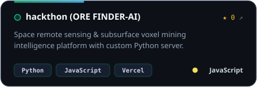
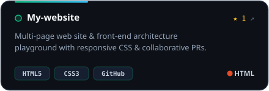
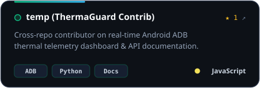
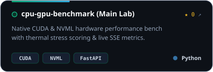
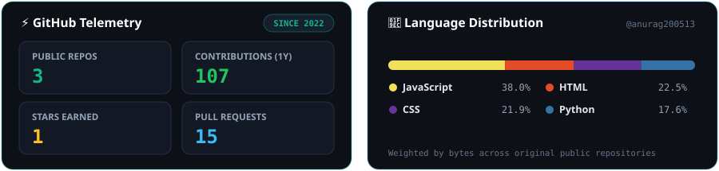

  

 

  

 

  

 

### 🛠️ Tech Stack &amp; Core Arsenal

  
    
     

 

### 🚀 Featured Engineering Projects

  
  
   
  
  

 

### 📊 Live GitHub Telemetry &amp; Streak

  
    
  

 

### 🌐 Connect &amp; Profile Ecosystem

  
  
  

 

  

